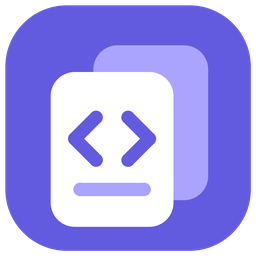

# Codebase Compiler

Turn a project folder into one readable text file. Choose what to exclude, review the file list, and export code from multiple languages without running the project.

**Built by [Dave](https://github.com/Davecaliamugos) · Windows 10 / 11 · 64-bit**

[User guide](USER-GUIDE.md) · [All releases](https://github.com/Davecaliamugos/Compiler-Downloads/releases) · [Changelog](CHANGELOG.md) · [Report an issue](https://github.com/Davecaliamugos/Compiler-Downloads/issues)

## Download

| Edition | Best for | How to use |
| --- | --- | --- |
| **Installer — recommended** | Everyday use on your own PC | Run the setup EXE. Get Start menu entries, an optional desktop shortcut, and an uninstaller. No administrator access needed. |
| **Portable** | A USB drive or a folder you can move | Extract the ZIP, then run `Codebase Compiler.exe`. Keep the folder writable so preferences can be saved. |

Both editions include Python. Git is optional and only needed to apply Git ignore rules.

**Use the download buttons above.** GitHub's **Code → Download ZIP** and automatic **Source code** release archives contain this download page and documentation, not the app. This repository distributes finished builds; application source is maintained privately.

Current builds are unsigned, so Windows may display a publisher warning. Each release includes `SHA256SUMS.txt` to [verify your download](USER-GUIDE.md#verify-a-download).

## Your first export

1. **Choose a project.** Browse to your codebase and choose a new `.txt` output file.
2. **Review exclusions.** Keep the defaults or adjust folder names, file patterns, and size limits.
3. **Preview the file list.** Search or filter included and skipped items, check reasons, and review the estimated export size.
4. **Export.** Save a single UTF-8 text file with relative paths separating each source file.

Read the [step-by-step user guide](USER-GUIDE.md) for installation, exclusion examples, profiles, settings, updates, and troubleshooting.

## Features

- **Mixed-language projects.** Combine readable UTF-8 source files, including files without extensions. Tested with a 502-file GUI export.
- **Useful defaults.** Skip dependencies, generated files, `.txt` files, `package.json`, common lockfiles, binaries, and known sensitive files.
- **Review before exporting.** See file paths, inclusion decisions, skip reasons, sizes, and estimated output size. The preview shows metadata rather than source contents.
- **Per-project profiles.** Remember exclusions, custom rules, output preferences, Git ignore handling, and limits for each folder.
- **Personal appearance.** System, Light, or Dark theme; three text sizes; startup preferences; and separate reset controls.
- **Local processing.** Scan and export on your computer. The app does not upload your code.

## Exclusions and limits

Default folder exclusions include `node_modules`, `packages`, `vendor`, virtual environments, build outputs, caches, and version-control directories. File defaults include `.txt`, `package.json`, common lockfiles, minified files, logs, archives, and media.

Environment files, private keys, credential files, known sensitive folders, detected secrets, symbolic links, and junctions remain excluded even if optional rules are disabled. Binary detection also stays enabled.

The default limits are **1 MiB per file** and **50 MiB of combined file blocks**. Adjust them in **Size limits**. Size exclusions can produce a partial export; review the final summary. UTF-16 and other non-UTF-8 files are skipped.

Automatic secret detection is best effort. Review the exported text before sharing it; paths and comments can also contain private information.

## Settings and updates

| Edition | Settings location | Updating |
| --- | --- | --- |
| Installed | `%LOCALAPPDATA%\Codebase Compiler\User Data\codebase-compiler.settings.json` | Close the app and run the newer installer. Settings and project profiles are preserved. |
| Portable | `codebase-compiler.settings.json` beside the EXE | Close the app and replace the EXE in the same folder, keeping the settings file. |

Uninstalling the installed edition keeps preferences and exported files. See the guide to [move portable preferences into an installation](USER-GUIDE.md#move-from-portable-to-installed).

## Help

See the [user guide](USER-GUIDE.md#troubleshooting), or [report an issue](https://github.com/Davecaliamugos/Compiler-Downloads/issues) with the app version, Windows version, steps, and relevant error text. Remove private paths, source code, and credentials before posting.

Created and maintained by **Dave**.
